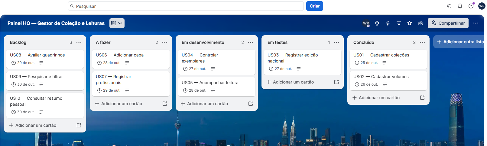
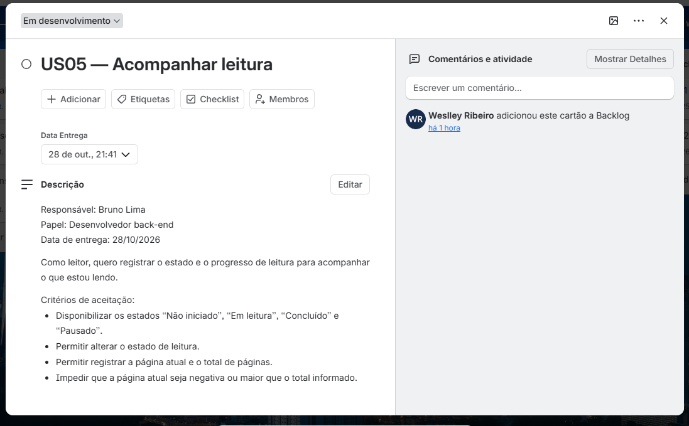

# Painel HQ — Requisitos e Planejamento Ágil

<div align="center">


</div>

Projeto acadêmico de engenharia de requisitos e planejamento ágil de Weslley Ribeiro para o Painel HQ, produto proposto para organizar quadrinhos, mangás e encadernados, situação de posse, leitura e avaliações pessoais. O escopo deste repositório é documental: não há aplicação implementada. As posições dos cartões e os prazos constituem uma simulação de planejamento.

## Meta do Produto

> Permitir que o leitor organize seus quadrinhos com informações da edição nacional e acompanhe sua coleção, suas leituras e avaliações pessoais.

A proposta do cliente foi organizada em dez histórias, com critérios de aceitação e prioridades. O cadastro manual compõe o escopo inicial; integrações externas não fazem parte dessa primeira delimitação. Posse e leitura são dimensões independentes.

## Artefatos

| Documento | Conteúdo |
| --- | --- |
| [Visão do produto](docs/visao-do-produto.md) | Necessidades, meta, escopo e fronteiras do domínio |
| [Product Backlog](docs/product-backlog.md) | US01 a US10, ordem, prioridades, responsáveis fictícios e prazos |
| [Critérios de aceitação](docs/criterios-de-aceitacao.md) | Regras verificáveis por história |
| [Equipe e governança](docs/equipe-governanca.md) | Papéis, fluxo e rastreabilidade da simulação |

## Priorização

US01 e US02 estabelecem coleções e volumes. US03 identifica a edição nacional; US04 e US05 organizam coleção pessoal e leitura. US06 e US07 enriquecem o catálogo. US08 e US09 ampliam registro pessoal e recuperação; US10 consolida os registros em resumo. As prioridades são Alta para US01–US05, Média para US06–US09 e Baixa para US10.

## Fluxo do quadro

```text
[Backlog: 3] -> [A fazer: 2] -> [Em desenvolvimento: 2] -> [Em testes: 1] -> [Concluido: 2]
 US08,09,10      US06,07              US04,05                  US03             US01,02
```

Esse retrato intermediário foi construído para o exercício. Concluído não indica entrega de código, e Em testes não comprova execução de testes. As datas de 25 a 30/10/2026 são prazos planejados, não datas de realização. A visualização em colunas não estabelece, isoladamente, práticas completas de Kanban ou execução integral do Scrum.

## Matriz de papéis

| Integrante | Papel simulado | Responsabilidade |
| --- | --- | --- |
| Ana Souza | Product Owner | Visão e ordenação do backlog |
| Weslley Ribeiro | Scrum Master | Facilitação e acompanhamento do fluxo |
| Bruno Lima | Desenvolvimento back-end | Regras e dados |
| Carla Mendes | Desenvolvimento front-end | Interface e interação |
| Diego Alves | QA | Verificação planejada dos critérios |

Os integrantes, exceto o autor, são fictícios. Esta é uma matriz de papéis, não uma RACI formal. As atribuições representam planejamento acadêmico, não experiência de emprego em uma equipe real.

## Regras de domínio centrais

- Coleções agrupam volumes; volume exige vínculo com coleção existente.
- Primeira impressão e reimpressão são diferenciadas; datas desconhecidas podem permanecer em branco.
- Posse admite Possuo, Desejo adquirir e Não possuo.
- Leitura admite Não iniciado, Em leitura, Concluído e Pausado.
- Progresso não pode ser negativo nem ultrapassar o total informado.
- Avaliação admite nota de 0 a 5 e comentário opcional; ausência de nota não equivale a zero.
- Profissionais podem exercer funções de roteirista ou desenhista, com múltiplos nomes por função.

## Registros da gestão visual

<div align="center">
  <h3>Quadro geral no Trello</h3>
  
  <p><em>Distribuição planejada de US01 a US10 no quadro de acompanhamento.</em></p>
  <h3>História US05 — Acompanhar leitura</h3>
  
  <p><em>Responsável fictício Bruno Lima, prazo previsto de 28/10/2026 e critérios especificados para progresso de leitura.</em></p>
</div>

## Rastreabilidade e origem

Os IDs conectam visão, backlog, critérios e cartões. A documentação foi consolidada a partir do [planejamento acadêmico original](https://github.com/Weslley-Ribeiro/Projetos-Faculdade/blob/main/Projeto-de-Software/Painel-HQ/PLANEJAMENTO-FINAL.md). Não se atribuem critérios validados, implementação ou testes automatizados aos estados da simulação. Os critérios estão em linguagem natural, sem suíte BDD executável.

## Licença

MIT, conforme LICENSE.
